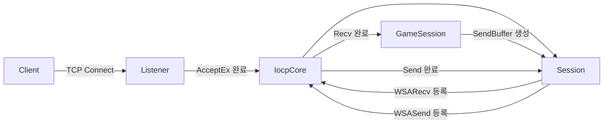

# MmoServer

Windows IOCP(I/O Completion Ports)를 기반으로 만든 C++ 비동기 TCP 서버 학습 프로젝트입니다.

현재는 여러 클라이언트의 접속과 비동기 송수신을 처리하는 네트워크 코어를 구축하고, 받은 바이트를 그대로 돌려주는 Echo Server까지 구현되어 있습니다. 최종 목표는 Protocol Buffers로 메시지 스키마를 정의하고 패킷 관련 코드를 자동 생성한 뒤, Unreal Engine 클라이언트와 실제 게임 패킷을 주고받는 것입니다.

> 이 프로젝트는 현재 개발 중입니다. Echo 통신은 가능하지만 패킷 프레이밍, Protocol Buffers 직렬화, 패킷 디스패처와 Unreal Engine 연동은 아직 구현되지 않았습니다.

## 현재 구현 상태

| 항목 | 상태 | 설명 |
| --- | :---: | --- |
| IOCP 이벤트 루프 | ✅ | 완료 통지 기반으로 네트워크 이벤트 처리 |
| 비동기 접속 수락 | ✅ | `AcceptEx` 요청을 미리 등록하고 완료 시 다음 요청 재등록 |
| 비동기 연결/해제 | ✅ | `ConnectEx`, `DisconnectEx` 기반 구조 |
| 비동기 송수신 | ✅ | `WSARecv`, `WSASend`와 Overlapped I/O 사용 |
| 세션/서비스 관리 | ✅ | 세션 생성, 보관, 해제, 브로드캐스트 지원 |
| 수신/송신 버퍼 | ✅ | 연속 수신 버퍼와 청크 재사용 기반 송신 버퍼 구현 |
| Echo Server | ✅ | 수신한 데이터를 그대로 클라이언트에 반환 |
| 패킷 헤더 | 🧱 | `size`, `id` 구조만 정의되어 있으며 파싱에는 아직 미사용 |
| Protocol Buffers | 📌 | 구현 예정 |
| 패킷 코드 자동 생성 | 📌 | 구현 예정 |
| Unreal Engine 연동 | 📌 | 구현 예정 |

## 기술 스택

- C++ / WinSock2
- Windows IOCP, Overlapped I/O
- Visual Studio 2022, MSVC v143
- Windows 10/11 SDK
- Python 3 (Echo 테스트 클라이언트)
- Protocol Buffers (도입 예정)
- Unreal Engine C++ 클라이언트 (연동 예정)

## 프로젝트 구조

```text
MmoServer/
├─ Common/                 # 서버와 클라이언트가 공유할 타입과 패킷 헤더
│  ├─ Types.h
│  ├─ Macro.h
│  └─ PacketHeader.h
├─ ServerCore/             # 게임 로직과 분리된 비동기 네트워크 코어
│  ├─ IocpCore.*           # IOCP 생성, 객체 등록, 완료 이벤트 디스패치
│  ├─ IocpObject.*         # IOCP에 등록 가능한 객체 인터페이스
│  ├─ IocpEvent.*          # Accept/Connect/Recv/Send/Disconnect 이벤트
│  ├─ Listener.*           # 리슨 소켓과 비동기 AcceptEx 처리
│  ├─ Session.*            # 연결 수명 주기와 비동기 송수신 관리
│  ├─ Service.*            # 세션 팩토리, 세션 집합, 브로드캐스트
│  ├─ ServerService.*      # 서버 리스너 시작/종료
│  ├─ ClientService.*      # 비동기 클라이언트 연결을 위한 기반 구조
│  ├─ RecvBuffer.*         # TCP 스트림 누적 및 읽기 위치 관리
│  ├─ SendBuffer*.{h,cpp}  # 송신 버퍼와 청크 풀
│  ├─ NetAddress.*         # IPv4 주소 래퍼
│  └─ SocketUtils.*        # WinSock 초기화와 확장 함수/옵션 래퍼
├─ MmoGameServer/          # 네트워크 코어를 사용하는 게임 서버 실행 파일
│  ├─ main.cpp
│  └─ GameSession.*        # 현재는 Echo 동작을 수행하는 세션
├─ echo_client.py          # 단일 클라이언트 Echo 테스트
├─ echo_multiclient.py     # 다중 클라이언트 Echo 테스트
└─ MmoServer.sln
```

의존성 방향은 다음과 같습니다.

```text
MmoGameServer ──> ServerCore ──> Common
       └───────────────────────> Common
```

게임 서버는 `Session`의 콜백만 재정의하고, 소켓과 IOCP의 세부 처리는 `ServerCore`가 담당합니다. 따라서 이후 로그인 서버, 채팅 서버 또는 더미 클라이언트를 만들 때도 동일한 네트워크 코어를 재사용할 수 있습니다.

## 처리 흐름



1. `ServerService`가 `Listener`를 만들고 리슨 소켓을 IOCP에 등록합니다.
2. `Listener`는 설정된 개수만큼 `AcceptEx`를 미리 요청합니다.
3. 접속이 완료되면 `SessionFactory`로 만든 세션을 서비스에 추가하고 수신을 등록합니다.
4. IOCP 작업 스레드가 완료 이벤트를 꺼내 해당 `IocpObject`로 전달합니다.
5. `GameSession::OnRecv()`가 수신 데이터를 처리합니다. 현재 구현은 같은 내용을 송신 버퍼에 복사하여 돌려줍니다.
6. 송신 요청은 세션별 큐에 모이며, 진행 중인 송신이 없을 때 `WSASend`를 등록합니다.

## 이렇게 설계한 이유

### IOCP 기반 완료 통지 모델

클라이언트마다 스레드를 하나씩 만드는 방식은 접속 수가 늘수록 스레드와 컨텍스트 스위칭 비용도 함께 증가합니다. IOCP는 소수의 작업 스레드가 다수의 소켓 완료 이벤트를 처리할 수 있어, 많은 동시 접속을 목표로 하는 서버의 기반으로 적합합니다.

### 네트워크 코어와 게임 로직 분리

`ServerCore`는 연결과 바이트 전송에만 집중하고, `GameSession`은 `OnConnected`, `OnRecv`, `OnSend`, `OnDisconnected`를 재정의해 게임별 동작을 구현합니다. 이 구조는 네트워크 코드를 수정하지 않고도 패킷 처리나 게임 로직을 교체할 수 있게 합니다.

### `Service`와 세션 팩토리

`Service`가 구체적인 세션 타입을 직접 알지 않고 `SessionFactory`를 통해 생성하도록 했습니다. 덕분에 서버/클라이언트 서비스가 같은 세션 수명 주기와 IOCP 코어를 공유하면서도 `GameSession` 같은 파생 타입을 주입할 수 있습니다.

### 이벤트가 작업 소유자를 보관

Overlapped I/O는 요청 함수가 반환된 뒤에도 비동기 작업이 계속됩니다. 각 `IocpEvent`가 작업 중 `shared_ptr<IocpObject>`를 보관하므로, 완료 통지가 도착하기 전에 세션이나 리스너가 소멸하는 문제를 막습니다. 완료 큐에서 이벤트를 꺼낸 뒤에는 참조를 해제하여 수명이 불필요하게 연장되지 않게 합니다.

### 연속 수신 버퍼

TCP는 메시지가 아니라 바이트 스트림입니다. 한 패킷이 여러 번에 나뉘어 도착하거나 여러 패킷이 한 번에 도착할 수 있으므로, `RecvBuffer`에 데이터를 누적하고 실제로 처리한 길이만큼 읽기 위치를 이동하는 구조를 사용합니다. 현재 Echo 단계에서는 받은 데이터를 전부 소비하지만, 이후 패킷 헤더를 해석할 때 이 구조가 패킷 조립의 기반이 됩니다.

### 송신 큐와 Gather I/O

동일 세션에서 여러 스레드가 동시에 `Send()`를 호출할 수 있으므로 송신 데이터를 큐에 넣고, 한 번에 하나의 비동기 송신 흐름만 등록합니다. 큐에 쌓인 여러 버퍼는 `WSABUF` 배열로 묶어 `WSASend`에 전달합니다. 이 방식은 송신 순서를 유지하고 시스템 호출 횟수를 줄이는 데 유리합니다.

### 청크 기반 송신 버퍼 재사용

패킷마다 힙 할당과 해제를 반복하면 부하가 커질 수 있습니다. `SendBufferManager`는 스레드 로컬 청크를 우선 사용하고, 사용이 끝난 청크를 전역 풀로 반환하여 송신 메모리를 재사용합니다. 패킷 생성기가 추가되면 직렬화 결과를 이 버퍼에 바로 기록하는 방향으로 확장할 수 있습니다.

## 빌드 및 실행

### 요구 사항

- Windows 10 또는 11
- Visual Studio 2022
  - **Desktop development with C++** 워크로드
  - MSVC v143 툴셋
  - Windows SDK
- 테스트 스크립트 실행 시 Python 3

### Visual Studio

1. `MmoServer.sln`을 엽니다.
2. 플랫폼을 `x64`, 구성을 `Debug` 또는 `Release`로 선택합니다.
3. `MmoGameServer`를 시작 프로젝트로 지정합니다.
4. 솔루션을 빌드하고 실행합니다.

서버는 현재 `127.0.0.1:7777`에서 대기합니다.

### 명령줄

Visual Studio Developer PowerShell에서 다음 명령을 사용할 수 있습니다.

```powershell
msbuild .\MmoServer.sln /m /p:Configuration=Debug /p:Platform=x64
```

서버 실행 후 별도 터미널에서 Echo 동작을 확인합니다.

```powershell
python .\echo_client.py
python .\echo_multiclient.py
```

`echo_multiclient.py`는 기본값으로 20개의 클라이언트를 만들고 각 클라이언트가 5개의 메시지를 송수신합니다.

## 패킷 규약 계획

Protocol Buffers를 사용하더라도 TCP 패킷 경계는 별도로 정의해야 합니다. 현재 `PacketHeader`를 바탕으로 다음과 같은 프레임을 구성할 계획입니다.

```text
┌──────────── uint16 ────────────┬──────────── uint16 ────────────┬──────── variable ────────┐
│ total size (header + payload)  │ packet id                     │ protobuf payload          │
└───────────────────────────────┴────────────────────────────────┴──────────────────────────┘
```

구현 시 함께 확정해야 할 항목은 다음과 같습니다.

- 헤더의 바이트 순서(network byte order 권장)
- 최대 패킷 크기와 잘못된 길이에 대한 연결 종료 정책
- 패킷 ID 할당 규칙과 중복 검증
- 메시지/프로토콜 버전 호환 정책
- 미등록 패킷과 역직렬화 실패 처리
- 부분 수신, 여러 패킷 동시 수신, 부분 송신 처리

## 로드맵

### 1. TCP 패킷 프레이밍 완성

- `[size][id][payload]` 형식 확정
- `RecvBuffer`에서 완성된 패킷만 반복해서 추출
- 패킷 분할 수신과 여러 패킷의 동시 수신 처리
- 패킷 크기 및 헤더 유효성 검증
- 부분 송신 시 남은 바이트를 이어 보내는 처리

### 2. Protocol Buffers 도입

- `.proto`를 서버와 클라이언트의 단일 메시지 정의로 사용
- `protoc` 빌드 과정 통합
- 공통 메시지, 클라이언트 요청, 서버 응답 스키마 분리
- 직렬화/역직렬화 실패와 버전 호환 테스트 추가

### 3. 패킷 코드 자동 생성

단순히 `.proto` 텍스트를 정규식으로 읽기보다 `protoc`의 descriptor set을 입력으로 사용하는 방식을 우선 고려합니다. 이 방식은 `package`, 중첩 메시지, import, option이 추가되어도 안정적으로 메타데이터를 읽을 수 있습니다.

자동 생성 대상의 예시는 다음과 같습니다.

- 충돌 없는 `PacketId` 열거형
- 메시지 타입과 패킷 ID 매핑
- 서버/클라이언트용 패킷 핸들러 등록 코드
- 역직렬화와 타입 검사를 포함한 디스패처
- `SendBuffer`에 직렬화하는 타입 안전 송신 헬퍼
- C++ 서버 및 Unreal Engine 클라이언트가 공유할 생성 파일

생성 파일은 직접 수정하지 않고 언제든 재생성할 수 있어야 하며, ID 중복이나 누락은 생성 단계에서 실패하도록 만들 계획입니다.

### 4. 네트워크 안정성 및 테스트 강화

- 단위 테스트: 헤더 파싱, 버퍼 경계, 잘못된 패킷
- 통합 테스트: 분할/병합 패킷, 재접속, 비정상 종료
- 다중 스레드 IOCP 테스트 및 동시 송신 검증
- 더미 클라이언트 수와 송수신량을 늘린 부하 테스트
- 정상 종료와 서버 셧다운 수명 주기 구현

### 5. Unreal Engine 연동

- Unreal 프로젝트에 protobuf 런타임을 Third-Party 모듈로 구성
- 서버와 동일한 `.proto` 및 패킷 ID 산출물을 빌드 과정에서 생성
- 소켓 수신/파싱은 별도 네트워크 스레드에서 수행
- Actor/UObject 접근은 Game Thread로 전달
- 연결, 재접속, 타임아웃, 에러 상태를 관리하는 클라이언트 모듈 구현
- 로그인 → 캐릭터 선택 → 월드 입장 → 이동 동기화 순으로 기능 확장

## 개발 방향에 대한 판단

**Protocol Buffers → 패킷 코드 자동 생성 → Unreal Engine 연동 순서는 좋은 방향입니다.** 서버와 클라이언트가 수동으로 구조체와 직렬화 코드를 각각 관리하는 일을 줄이고, 메시지 스키마를 하나의 원본으로 유지할 수 있기 때문입니다. 필드 추가에도 비교적 유연해 게임 프로토콜을 반복해서 바꾸는 개발 단계와도 잘 맞습니다.

다만 성공 여부는 protobuf 자체보다 그 주변 규약에 달려 있습니다. protobuf는 메시지의 직렬화 형식을 제공하지만 TCP 프레이밍, 패킷 ID, 디스패치, 스레드 전환, 최대 크기와 오류 정책까지 해결해 주지는 않습니다. 따라서 Unreal 연동 전에 프레이밍과 생성기의 입력/출력 규칙을 먼저 고정하고, 서버와 간단한 테스트 클라이언트 사이에서 충분히 검증하는 편이 좋습니다.

특히 Unreal에서는 네트워크 콜백에서 UObject나 Actor를 직접 만지지 않고 Game Thread로 넘기는 경계를 명확히 해야 합니다. 이 원칙과 생성 코드의 책임 범위만 초기에 잘 정하면, 현재 구조는 Unreal 기반 MMO 통신을 확장하기에 괜찮은 출발점입니다.

## License

라이선스는 아직 지정되지 않았습니다.
